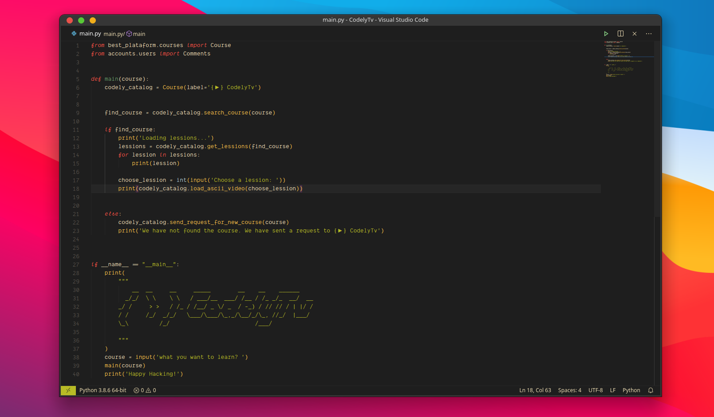

<h1 align="center">
  <🎨> Codely Theme for VS Code
</h1>

    
    

    
    A modern, good-looking, productivity-increaser theme for Visual Studio and compatible IDEs.  
    <a href="https://github.com/CodelyTV/vscode-theme/stargazers">Stars are welcome 😊</a>

## 🤝 Compatible editors

- Visual Studio Code
- Cursor
- VSCodium
- GitHub Codespaces
- CodeSandbox
- StackBlitz
- Any other editor supporting VS Code themes

## 🔗 Related links

- [VS Marketplace theme](https://marketplace.visualstudio.com/items?itemName=codely.codely-theme)
- [Codely Theme for JetBrains IDEs](https://github.com/CodelyTV/jetbrains-theme)

  <small>Happy hacking!</small> 
  🐢 💨 (Turbotuga™, <a href="https://codely.com">Codely</a>’s mascot).

